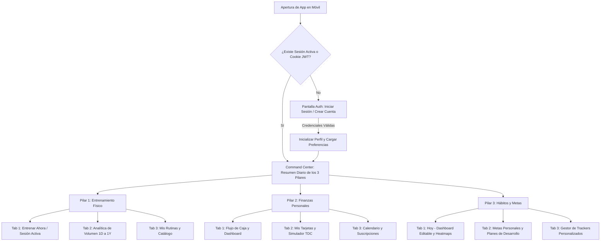

# 03. Appflow — Mapa de Navegación y Flujos de Usuario: TRIFECTA LifeOS

## 1. La arquitectura de navegación móvil elimina menús laterales ocultos y opera mediante una barra de control superior de un toque

En dispositivos móviles, el `st.sidebar` de Streamlit permanece colapsado por defecto y obliga al usuario a realizar toques adicionales en la esquina superior izquierda. Por ello, **TRIFECTA LifeOS** oculta o minimiza la barra lateral para acciones secundarias (perfil y cerrar sesión) y centra toda la navegación principal en un **Selector Segmentado Superior Fijo** con 4 destinos principales:

## 2. Flujo de Autenticación y Onboarding Inicial (`auth_view.py`)

| Paso del Usuario | Elemento de Interfaz Accionado | Respuesta del Sistema / Lógica Interna | Pantalla o Estado Resultante |
| :--- | :--- | :--- | :--- |
| **1. Acceso inicial sin sesión** | Abre la URL de Streamlit en su smartphone | Verifica `st.session_state["user"]` y cookie `trifecta_rt`. Si ambos están vacíos, bloquea las vistas privadas. | Muestra tarjeta centrada con pestañas **Iniciar Sesión** y **Crear Cuenta**. |
| **2. Registro de nuevo usuario** | Completa `Nombre`, `Email`, `Contraseña` y pulsa botón `Crear mi cuenta` | Ejecuta `supabase.auth.sign_up()`. El trigger de base de datos crea automáticamente su fila en `profiles` y sus categorías financieras base. | Inicia sesión automáticamente, guarda cookie `trifecta_rt` y redirige al **Command Center**. |
| **3. Inicio de sesión recurrente** | Ingresa `Email`, `Contraseña` y pulsa `Entrar` | Ejecuta `supabase.auth.sign_in_with_password()`, inyecta el JWT en PostgREST y guarda el `refresh_token` en cookie por 30 días. | Carga el **Command Center** personalizado con los datos exclusivos de ese `user_id`. |
| **4. Cierre de sesión** | Pulsa el icono de usuario en la esquina superior derecha y selecciona `Cerrar Sesión` | Ejecuta `supabase.auth.sign_out()`, borra la cookie `trifecta_rt` y limpia `st.session_state` y cachés. | Regresa a la pantalla de **Iniciar Sesión**. |

## 3. Flujo del Command Center — Resumen Diario Unificado (`home_hub_view.py`)

Al abrir la app cada mañana, el usuario aterriza en una vista ejecutiva que resume el estado de sus 3 ramas de vida en una sola pantalla vertical sin desplazamiento excesivo:

* **Bloque 1 — Estado de Entrenamiento del Día:** Muestra la rutina toca hoy (o el último entrenamiento registrado), el volumen acumulado en los últimos 7 días y un botón de acción rápida `Iniciar Entrenamiento`.
* **Bloque 2 — Pulso Financiero y Próximo Vencimiento:** Muestra el disponible del presupuesto mensual, el gasto del día, la próxima tarjeta a cortar o pagar en los siguientes 7 días y un botón rápido `+ Registrar Movimiento`.
* **Bloque 3 — Progreso de Hábitos de Hoy:** Muestra la barra de cumplimiento diario (ej. `4 de 6 completados hoy — 67%`) y permite marcar los hábitos pendientes directamente desde el inicio.

## 4. Flujo Detallado del Pilar 1: Entrenamiento Físico (`workout_view.py`)

### 4.1. Sub-flujo A: Ejecución de una Sesión en Vivo y Sobrecarga Progresiva (`Tab: Entrenar`)

1. **Selección de Rutina o Sesión Libre:**
   * El usuario pulsa `Iniciar Rutina` sobre una de sus plantillas (ej. *Push / Empuje A*, *Pierna Hipertrofia*, *Upper Body*) o pulsa `Sesión Libre`.
   * El sistema crea un registro activo en memoria (`st.session_state["active_workout"]`) con cronómetro de inicio y carga la lista de ejercicios programados.
2. **Lectura del Banner de Recomendación Algorítmica:**
   * Debajo del título de cada ejercicio (ej. *Press Inclinado con Mancuernas — Rango objetivo: 8–12 reps*), el sistema consulta las últimas 2 sesiones de ese ejercicio para ese `user_id` y despliega una insignia de recomendación:
     * **Insignia Verde (`Subir Peso`):** *"Última vez: 30 kg × 12, 12, 12 (RPE 8). Hoy: Sube a **32.5 kg × 8–9 reps**."*
     * **Insignia Azul (`Subir Reps`):** *"Última vez: 30 kg × 9, 9, 8 (RPE 8.5). Hoy: Mantén **30 kg** y busca **10–10–9 reps**."*
     * **Insignia Ámbar (`Ajuste Técnico / Descarga`):** *"Fatiga detectada en última sesión (RPE 10). Hoy: Baja a **27.5 kg** y busca **12–14 reps** controladas."*
   * Al lado del banner aparece el botón `Aplicar sugerencia`, que pre-rellena automáticamente las cajas de `Peso (kg)` y `Reps` de la serie actual.
3. **Captura de Serie por Serie (Fragmento Reactivo):**
   * El usuario confirma o ajusta `Tipo de Serie` (`W` Calentamiento, `N` Efectiva, `D` Dropset, `F` Al Fallo), `Peso (kg)`, `Reps` y `RPE` (`6.0` a `10.0`), y pulsa el botón `✔ Guardar Serie`.
   * El sistema calcula al instante el `1RM Estimado = peso * (1 + reps / 30)` y el `Volumen = peso * reps`. Si el `1RM` o el peso para esas repeticiones supera el récord histórico del usuario, muestra una notificación `🏆 ¡Nuevo PR Personal!`.
4. **Finalización y Guardado en Base de Datos:**
   * Al concluir la rutina, el usuario pulsa `Finalizar Entrenamiento`.
   * El sistema realiza el `INSERT` transaccional de la sesión (`workout_sessions`) y sus series (`workout_sets`) en Supabase, limpia la caché de analítica y muestra el resumen de la sesión (Tonelaje total movido, series efectivas por músculo y récords batidos).

### 4.2. Sub-flujo B: Analítica de Volumen por Músculo en los 8 Horizontes Temporales (`Tab: Analítica`)

1. **Selección del Filtro Temporal (8 Opciones):**
   * En la parte superior de la pestaña, el usuario pulsa uno de los 8 selectores horizontales: `1D` | `1W` | `2W` | `1M` | `2M` | `3M` | `6M` | `1Y`.
2. **Conmutación de Métrica y Filtro Muscular:**
   * El usuario puede alternar entre **Series Efectivas (ponderadas 1.0 primario / 0.5 secundario)** y **Tonelaje Total (kg)**, y filtrar todos los músculos o seleccionar uno específico (ej. *Pecho*, *Espalda*, *Cuádriceps*, *Isquios*, *Hombros*, *Bíceps*, *Tríceps*).
3. **Visualización Interactiva:**
   * **Gráfica 1 (Distribución por Grupo Muscular):** Gráfica de barras horizontales comparando las series efectivas logradas en el periodo contra la zona óptima de hipertrofia (`10–20 series/semana` escaladas al periodo elegido).
   * **Gráfica 2 (Evolución Temporal):** Gráfica de barras/líneas apiladas mostrando la tendencia a lo largo del horizonte seleccionado (`1D` a `1Y`) y el indicador porcentual de crecimiento o caída respecto al periodo inmediato anterior.

## 5. Flujo Detallado del Pilar 2: Finanzas Personales (`finance_view.py`)

### 5.1. Sub-flujo A: Registro Rápido de Flujo de Caja y Dashboard (`Tab: Flujo y Dashboard`)

1. **Botón de Acción Principal (`+ Nuevo Movimiento`):**
   * Abre un modal `@st.dialog` donde el usuario selecciona el tipo (`Gasto`, `Ingreso`, `Transferencia entre cuentas`), ingresa el `Monto ($)`, elige la `Cuenta/Tarjeta`, la `Categoría` (con su barra de presupuesto restante visible en vivo) y la `Fecha`.
   * Al pulsar `Guardar Movimiento`, el sistema inserta en `finance_transactions` y actualiza automáticamente el saldo de la cuenta o el saldo utilizado de la tarjeta de crédito.
2. **Exploración del Dashboard Financiero:**
   * Muestra 3 KPIs superiores: **Liquidez Disponible (Débito/Efectivo)**, **Gasto del Mes vs. Presupuesto** y **Deuda Total en TDC**.
   * Renderiza la gráfica de flujo neto mensual (Ingresos vs. Gastos) y la gráfica de anillo de gastos por categoría con alerta visual en las categorías que superen el `85%` de su presupuesto.

### 5.2. Sub-flujo B: Billetera Moderna y Simulador "¿Con qué tarjeta pago hoy?" (`Tab: Tarjetas y Simulador`)

1. **Carrusel/Cuadrícula de Tarjetas Modernas:**
   * Cada tarjeta registrada se dibuja como una tarjeta bancaria estilizada en modo oscuro con su color institucional, nombre del banco, últimos 4 dígitos, barra de línea de crédito ocupada, **próximo día de corte**, **próxima fecha límite de pago** y tasa de **Cashback**.
   * El botón `+ Agregar Cuenta o TDC` abre un modal para dar de alta nuevas tarjetas configurando su `cutoff_day`, `payment_due_day` y `cashback_pct`.
2. **Ejecución del Simulador de Decisión y Conveniencia de TDC:**
   * El usuario escribe en el panel del simulador: **Monto a gastar** (ej. `$4,500 MXN`), **Categoría** (ej. *Tecnología / Compras*) y **Fecha planeada de compra** (por defecto hoy).
   * Al pulsar `Analizar Mejor Método de Pago`, el motor `card_advisor_engine.py` evalúa todas las TDC del usuario y despliega:
     * **Tarjeta Ganadora Destacada (Ranking #1):** Muestra la insignia `⭐ Mejor Opción Hoy (Score: 94/100)`, indicando exactamente:
       * **Días de financiamiento sin intereses:** *"46 días para pagar (Corta el 15 Nov, pagas hasta el 05 Dic)"*.
       * **Cashback generado:** *"Recibes $90.00 MXN (2.0%)"*.
       * **Impacto en línea de crédito:** *"Tu utilización pasará de 18% a 26% (Saludable <30%)"*.
     * **Impacto en Presupuesto:** Muestra si la compra cabe dentro del presupuesto mensual de esa categoría o en cuánto lo excedería, permitiendo incluso simular *"¿Qué pasa si espero 3 días a que corte la tarjeta X?"*.

### 5.3. Sub-flujo C: Calendario Financiero, Suscripciones e Importación Asistida de PDF (`Tab: Calendario`)

1. **Calendario Mensual de Eventos Financieros:**
   * Presenta los días del mes actual con indicadores de color: Azul para **Días de Corte de TDC**, Rojo/Ámbar para **Fechas Límite de Pago de TDC**, Morado para **Cobros de Suscripciones Recurrentes** y Verde para **Quincenas/Ingresos**.
2. **Gestor de Suscripciones:**
   * Lista las suscripciones activas con su costo mensual/anual, tarjeta asociada y botón `Registrar cobro del mes` en un toque.
3. **Importador Asistido de Estado de Cuenta PDF (Módulo Fase 2):**
   * Incluye un desplegable `📄 Importar Estado de Cuenta (PDF)` donde el usuario sube su archivo, revisa las transacciones detectadas en una tabla interactiva `st.data_editor`, corrige cualquier categoría si lo desea y confirma la inserción masiva.

## 6. Flujo Detallado del Pilar 3: Hábitos y Desarrollo Personal (`habits_view.py`)

### 6.1. Sub-flujo A: Dashboard Diario con Orden Editable y Heatmaps (`Tab: Hoy`)

1. **Registro Diario Personalizado según Tipo de Métrica:**
   * El usuario ve sus hábitos activos ordenados según su preferencia (`display_order`):
     * Si el hábito es `BOOLEAN`: pulsa el botón de check para completarlo en 1 toque.
     * Si el hábito es `NUMERIC` o `DURATION`: usa el control rápido `+` / `-` o ingresa el valor del día (ej. `2.5 L` de agua o `45 min` de lectura) viendo cómo se llena la barra hacia su meta diaria.
     * Si el hábito es `RATING`: desliza el selector de `1 a 10` para calificar su día.
2. **Edición del Orden del Dashboard (`Modo Personalizar Vista`):**
   * Al activar el interruptor `Reordenar Dashboard`, cada tarjeta muestra flechas `⬆ Subir` / `⬇ Bajar` y un botón `📌 Fijar arriba`. Cualquier cambio actualiza `display_order` en Supabase y reordena la vista móvil al instante.
3. **Visualización de Consistencia (Heatmaps):**
   * Debajo de cada hábito (o en vista expandida) se dibuja su mapa de calor de los últimos 90 días junto con su `Racha Actual 🔥`, `Mejor Racha Histórica` y `% de Cumplimiento Mensual`.

### 6.2. Sub-flujo B: Metas Personales (Año Nuevo) y Planes de Desarrollo (`Tab: Metas y Planes`)

1. **Creación de Meta Personal y Plan de Desarrollo:**
   * El usuario pulsa `+ Nueva Meta / Propósito`, define el título (ej. *"Bajar a 12% de grasa corporal"* o *"Lanzar proyecto secundario"*), la fecha objetivo, el área de vida y agrega sus **Hitos del Plan de Desarrollo** (pasos secuenciales) además de vincular qué hábitos diarios alimentan esa meta.
2. **Seguimiento de Avance Integrado:**
   * Cada vez que el usuario marca como completado un hito de su plan o mantiene la adherencia en los hábitos vinculados, la tarjeta de la Meta Personal actualiza su porcentaje de completitud y muestra qué hito sigue en su hoja de ruta.
