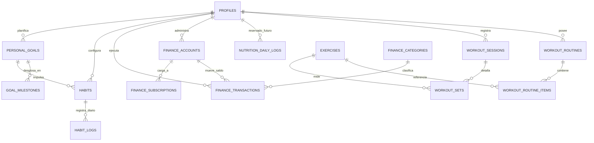

# 05. Backend Schema — Esquema Relacional y Seguridad Multiusuario en Supabase: TRIFECTA LifeOS

## 1. El diseño relacional en PostgreSQL aísla a los usuarios mediante Row Level Security (RLS) e integra los tres pilares más la base de Nutrición

Todas las tablas de usuario incluyen `user_id UUID NOT NULL REFERENCES auth.users(id) ON DELETE CASCADE` y políticas estrictas `USING (auth.uid() = user_id)` para que cada uno de los ~10 usuarios acceda exclusivamente a su propia información.



## 2. Script SQL DDL completo y ejecutable para el SQL Editor de Supabase (`sql/01_schema_ddl.sql`)

Este script crea todas las tablas, restricciones, índices de velocidad para los 8 filtros temporales, conectores futuros de Nutrición, tabla de importación PDF y políticas RLS:

```sql
-- ============================================================================
-- TRIFECTA LifeOS — Esquema Completo PostgreSQL + RLS para Supabase
-- ============================================================================

CREATE EXTENSION IF NOT EXISTS "pgcrypto";

-- ----------------------------------------------------------------------------
-- 0. NÚCLEO: PERFILES DE USUARIO Y TRIGGER DE REGISTRO AUTOMÁTICO
-- ----------------------------------------------------------------------------
CREATE TABLE IF NOT EXISTS public.profiles (
    id UUID PRIMARY KEY REFERENCES auth.users(id) ON DELETE CASCADE,
    email TEXT UNIQUE NOT NULL,
    full_name TEXT NOT NULL DEFAULT 'Usuario Trifecta',
    preferred_currency TEXT NOT NULL DEFAULT 'MXN',
    weight_unit TEXT NOT NULL DEFAULT 'kg' CHECK (weight_unit IN ('kg', 'lb')),
    created_at TIMESTAMPTZ NOT NULL DEFAULT NOW(),
    updated_at TIMESTAMPTZ NOT NULL DEFAULT NOW()
);

ALTER TABLE public.profiles ENABLE ROW LEVEL SECURITY;
CREATE POLICY "profiles_self_policy" ON public.profiles
    FOR ALL USING (auth.uid() = id) WITH CHECK (auth.uid() = id);

-- Trigger que crea el perfil automáticamente cuando un usuario se registra en Supabase Auth
CREATE OR REPLACE FUNCTION public.handle_new_user()
RETURNS TRIGGER LANGUAGE plpgsql SECURITY DEFINER AS $$
BEGIN
    INSERT INTO public.profiles (id, email, full_name)
    VALUES (
        NEW.id,
        NEW.email,
        COALESCE(NEW.raw_user_meta_data->>'full_name', split_part(NEW.email, '@', 1))
    );
    RETURN NEW;
END;
$$;

DROP TRIGGER IF EXISTS on_auth_user_created ON auth.users;
CREATE TRIGGER on_auth_user_created
    AFTER INSERT ON auth.users
    FOR EACH ROW EXECUTE FUNCTION public.handle_new_user();

-- ----------------------------------------------------------------------------
-- 1. PILAR 1: ENTRENAMIENTO FÍSICO + CONECTOR FUTURO DE NUTRICIÓN
-- ----------------------------------------------------------------------------

-- 1.1 Catálogo de ejercicios (ejercicios globales tienen user_id IS NULL; personalizados tienen user_id)
CREATE TABLE IF NOT EXISTS public.exercises (
    id UUID PRIMARY KEY DEFAULT gen_random_uuid(),
    user_id UUID REFERENCES auth.users(id) ON DELETE CASCADE,
    name TEXT NOT NULL,
    equipment TEXT NOT NULL DEFAULT 'barbell'
        CHECK (equipment IN ('barbell', 'dumbbell', 'machine', 'cable', 'bodyweight', 'kettlebell', 'other')),
    primary_muscle TEXT NOT NULL
        CHECK (primary_muscle IN (
            'chest', 'back_lats', 'back_upper', 'quads', 'hamstrings', 'glutes',
            'front_delts', 'side_delts', 'rear_delts', 'biceps', 'triceps', 'calves', 'abs', 'forearms'
        )),
    secondary_muscles TEXT[] NOT NULL DEFAULT '{}',
    movement_pattern TEXT NOT NULL DEFAULT 'compound' CHECK (movement_pattern IN ('compound', 'isolation')),
    created_at TIMESTAMPTZ NOT NULL DEFAULT NOW()
);

ALTER TABLE public.exercises ENABLE ROW LEVEL SECURITY;
CREATE POLICY "exercises_read_global_or_own" ON public.exercises
    FOR SELECT USING (user_id IS NULL OR auth.uid() = user_id);
CREATE POLICY "exercises_write_own" ON public.exercises
    FOR INSERT WITH CHECK (auth.uid() = user_id);
CREATE POLICY "exercises_update_own" ON public.exercises
    FOR UPDATE USING (auth.uid() = user_id) WITH CHECK (auth.uid() = user_id);
CREATE POLICY "exercises_delete_own" ON public.exercises
    FOR DELETE USING (auth.uid() = user_id);

-- 1.2 Plantillas de Rutinas del Usuario
CREATE TABLE IF NOT EXISTS public.workout_routines (
    id UUID PRIMARY KEY DEFAULT gen_random_uuid(),
    user_id UUID NOT NULL REFERENCES auth.users(id) ON DELETE CASCADE,
    name TEXT NOT NULL,
    description TEXT DEFAULT '',
    accent_color TEXT NOT NULL DEFAULT '#FF5500',
    display_order INT NOT NULL DEFAULT 1,
    is_archived BOOLEAN NOT NULL DEFAULT FALSE,
    created_at TIMESTAMPTZ NOT NULL DEFAULT NOW()
);

ALTER TABLE public.workout_routines ENABLE ROW LEVEL SECURITY;
CREATE POLICY "workout_routines_owner" ON public.workout_routines
    FOR ALL USING (auth.uid() = user_id) WITH CHECK (auth.uid() = user_id);

-- 1.3 Ejercicios asignados a cada Rutina (con rangos objetivo para el motor de sobrecarga progresiva)
CREATE TABLE IF NOT EXISTS public.workout_routine_items (
    id UUID PRIMARY KEY DEFAULT gen_random_uuid(),
    user_id UUID NOT NULL REFERENCES auth.users(id) ON DELETE CASCADE,
    routine_id UUID NOT NULL REFERENCES public.workout_routines(id) ON DELETE CASCADE,
    exercise_id UUID NOT NULL REFERENCES public.exercises(id) ON DELETE RESTRICT,
    order_index INT NOT NULL DEFAULT 1,
    target_sets INT NOT NULL DEFAULT 3 CHECK (target_sets BETWEEN 1 AND 15),
    target_rep_min INT NOT NULL DEFAULT 8 CHECK (target_rep_min >= 1),
    target_rep_max INT NOT NULL DEFAULT 12 CHECK (target_rep_max >= target_rep_min),
    target_rpe NUMERIC(3,1) NOT NULL DEFAULT 8.0 CHECK (target_rpe BETWEEN 5.0 AND 10.0),
    progression_step_kg NUMERIC(5,2) NOT NULL DEFAULT 2.50,
    notes TEXT DEFAULT ''
);

ALTER TABLE public.workout_routine_items ENABLE ROW LEVEL SECURITY;
CREATE POLICY "workout_routine_items_owner" ON public.workout_routine_items
    FOR ALL USING (auth.uid() = user_id) WITH CHECK (auth.uid() = user_id);

-- 1.4 Sesiones de Entrenamiento Ejecutadas
CREATE TABLE IF NOT EXISTS public.workout_sessions (
    id UUID PRIMARY KEY DEFAULT gen_random_uuid(),
    user_id UUID NOT NULL REFERENCES auth.users(id) ON DELETE CASCADE,
    routine_id UUID REFERENCES public.workout_routines(id) ON DELETE SET NULL,
    session_title TEXT NOT NULL,
    started_at TIMESTAMPTZ NOT NULL DEFAULT NOW(),
    ended_at TIMESTAMPTZ,
    duration_minutes INT GENERATED ALWAYS AS (
        CASE WHEN ended_at IS NOT NULL
             THEN GREATEST(1, EXTRACT(EPOCH FROM (ended_at - started_at))::INT / 60)
             ELSE NULL END
    ) STORED,
    perceived_fatigue INT CHECK (perceived_fatigue BETWEEN 1 AND 10),
    bodyweight_kg NUMERIC(5,2),
    notes TEXT DEFAULT '',
    created_at TIMESTAMPTZ NOT NULL DEFAULT NOW()
);

CREATE INDEX IF NOT EXISTS idx_workout_sessions_user_started
    ON public.workout_sessions (user_id, started_at DESC);

ALTER TABLE public.workout_sessions ENABLE ROW LEVEL SECURITY;
CREATE POLICY "workout_sessions_owner" ON public.workout_sessions
    FOR ALL USING (auth.uid() = user_id) WITH CHECK (auth.uid() = user_id);

-- 1.5 Series Individuales Registradas (con cálculo automático de Tonelaje y 1RM Estimado)
CREATE TABLE IF NOT EXISTS public.workout_sets (
    id UUID PRIMARY KEY DEFAULT gen_random_uuid(),
    user_id UUID NOT NULL REFERENCES auth.users(id) ON DELETE CASCADE,
    session_id UUID NOT NULL REFERENCES public.workout_sessions(id) ON DELETE CASCADE,
    exercise_id UUID NOT NULL REFERENCES public.exercises(id) ON DELETE RESTRICT,
    set_number INT NOT NULL CHECK (set_number >= 1),
    set_type TEXT NOT NULL DEFAULT 'working'
        CHECK (set_type IN ('warmup', 'working', 'dropset', 'failure')),
    weight_kg NUMERIC(6,2) NOT NULL DEFAULT 0 CHECK (weight_kg >= 0),
    reps INT NOT NULL CHECK (reps >= 0),
    rpe NUMERIC(3,1) DEFAULT 8.0 CHECK (rpe BETWEEN 5.0 AND 10.0),
    tonnage_kg NUMERIC(10,2) GENERATED ALWAYS AS (weight_kg * reps) STORED,
    estimated_1rm NUMERIC(8,2) GENERATED ALWAYS AS (
        CASE WHEN reps > 0 THEN ROUND(weight_kg * (1.0 + (reps::NUMERIC / 30.0)), 2) ELSE 0 END
    ) STORED,
    is_pr BOOLEAN NOT NULL DEFAULT FALSE,
    performed_at TIMESTAMPTZ NOT NULL DEFAULT NOW()
);

CREATE INDEX IF NOT EXISTS idx_workout_sets_user_performed
    ON public.workout_sets (user_id, performed_at DESC);
CREATE INDEX IF NOT EXISTS idx_workout_sets_user_exercise
    ON public.workout_sets (user_id, exercise_id, performed_at DESC);

ALTER TABLE public.workout_sets ENABLE ROW LEVEL SECURITY;
CREATE POLICY "workout_sets_owner" ON public.workout_sets
    FOR ALL USING (auth.uid() = user_id) WITH CHECK (auth.uid() = user_id);

-- 1.6 BASE ARQUITECTÓNICA RESERVADA PARA FUTURO MÓDULO DE NUTRICIÓN
CREATE TABLE IF NOT EXISTS public.nutrition_targets (
    id UUID PRIMARY KEY DEFAULT gen_random_uuid(),
    user_id UUID NOT NULL UNIQUE REFERENCES auth.users(id) ON DELETE CASCADE,
    goal_phase TEXT NOT NULL DEFAULT 'maintenance'
        CHECK (goal_phase IN ('cut', 'maintenance', 'lean_bulk')),
    daily_calories_target INT NOT NULL DEFAULT 2400,
    protein_g_target INT NOT NULL DEFAULT 160,
    carbs_g_target INT NOT NULL DEFAULT 250,
    fat_g_target INT NOT NULL DEFAULT 75,
    updated_at TIMESTAMPTZ NOT NULL DEFAULT NOW()
);

ALTER TABLE public.nutrition_targets ENABLE ROW LEVEL SECURITY;
CREATE POLICY "nutrition_targets_owner" ON public.nutrition_targets
    FOR ALL USING (auth.uid() = user_id) WITH CHECK (auth.uid() = user_id);

CREATE TABLE IF NOT EXISTS public.nutrition_daily_logs (
    id UUID PRIMARY KEY DEFAULT gen_random_uuid(),
    user_id UUID NOT NULL REFERENCES auth.users(id) ON DELETE CASCADE,
    log_date DATE NOT NULL DEFAULT CURRENT_DATE,
    calories_kcal INT NOT NULL DEFAULT 0,
    protein_g NUMERIC(5,1) NOT NULL DEFAULT 0,
    carbs_g NUMERIC(5,1) NOT NULL DEFAULT 0,
    fat_g NUMERIC(5,1) NOT NULL DEFAULT 0,
    water_ml INT NOT NULL DEFAULT 0,
    bodyweight_kg NUMERIC(5,2),
    notes TEXT DEFAULT '',
    UNIQUE (user_id, log_date)
);

ALTER TABLE public.nutrition_daily_logs ENABLE ROW LEVEL SECURITY;
CREATE POLICY "nutrition_daily_logs_owner" ON public.nutrition_daily_logs
    FOR ALL USING (auth.uid() = user_id) WITH CHECK (auth.uid() = user_id);

-- ----------------------------------------------------------------------------
-- 2. PILAR 2: FINANZAS PERSONALES, TARJETAS MODERNAS Y SIMULADOR TDC
-- ----------------------------------------------------------------------------

-- 2.1 Cuentas y Tarjetas (Débito, Efectivo, Inversión y Tarjetas de Crédito con Corte/Pago/Cashback)
CREATE TABLE IF NOT EXISTS public.finance_accounts (
    id UUID PRIMARY KEY DEFAULT gen_random_uuid(),
    user_id UUID NOT NULL REFERENCES auth.users(id) ON DELETE CASCADE,
    name TEXT NOT NULL,
    institution_name TEXT NOT NULL DEFAULT 'Banco',
    account_type TEXT NOT NULL
        CHECK (account_type IN ('debit', 'cash', 'investment', 'credit_card')),
    card_network TEXT DEFAULT 'visa'
        CHECK (card_network IN ('visa', 'mastercard', 'amex', 'other')),
    last_four_digits TEXT DEFAULT '0000',
    card_gradient_theme TEXT NOT NULL DEFAULT 'indigo_neon',
    current_balance NUMERIC(12,2) NOT NULL DEFAULT 0.00,
    -- Campos exclusivos para Tarjetas de Crédito (TDC):
    credit_limit NUMERIC(12,2) DEFAULT 0.00 CHECK (credit_limit >= 0),
    cutoff_day INT CHECK (cutoff_day BETWEEN 1 AND 31),
    payment_due_day INT CHECK (payment_due_day BETWEEN 1 AND 31),
    cashback_pct NUMERIC(4,2) NOT NULL DEFAULT 0.00 CHECK (cashback_pct >= 0),
    annual_fee NUMERIC(10,2) NOT NULL DEFAULT 0.00,
    interest_rate_cat NUMERIC(5,2) DEFAULT 0.00,
    is_active BOOLEAN NOT NULL DEFAULT TRUE,
    created_at TIMESTAMPTZ NOT NULL DEFAULT NOW()
);

ALTER TABLE public.finance_accounts ENABLE ROW LEVEL SECURITY;
CREATE POLICY "finance_accounts_owner" ON public.finance_accounts
    FOR ALL USING (auth.uid() = user_id) WITH CHECK (auth.uid() = user_id);

-- 2.2 Categorías Financieras y Presupuestos Mensuales
CREATE TABLE IF NOT EXISTS public.finance_categories (
    id UUID PRIMARY KEY DEFAULT gen_random_uuid(),
    user_id UUID NOT NULL REFERENCES auth.users(id) ON DELETE CASCADE,
    name TEXT NOT NULL,
    kind TEXT NOT NULL CHECK (kind IN ('expense', 'income', 'transfer')),
    monthly_budget_limit NUMERIC(12,2) NOT NULL DEFAULT 0.00 CHECK (monthly_budget_limit >= 0),
    icon TEXT NOT NULL DEFAULT '💳',
    color_hex TEXT NOT NULL DEFAULT '#10B981',
    is_essential BOOLEAN NOT NULL DEFAULT TRUE,
    UNIQUE (user_id, name, kind)
);

ALTER TABLE public.finance_categories ENABLE ROW LEVEL SECURITY;
CREATE POLICY "finance_categories_owner" ON public.finance_categories
    FOR ALL USING (auth.uid() = user_id) WITH CHECK (auth.uid() = user_id);

-- 2.3 Movimientos Financieros (Ingresos, Gastos y Transferencias)
CREATE TABLE IF NOT EXISTS public.finance_transactions (
    id UUID PRIMARY KEY DEFAULT gen_random_uuid(),
    user_id UUID NOT NULL REFERENCES auth.users(id) ON DELETE CASCADE,
    account_id UUID NOT NULL REFERENCES public.finance_accounts(id) ON DELETE CASCADE,
    destination_account_id UUID REFERENCES public.finance_accounts(id) ON DELETE SET NULL,
    category_id UUID REFERENCES public.finance_categories(id) ON DELETE SET NULL,
    tx_type TEXT NOT NULL CHECK (tx_type IN ('expense', 'income', 'transfer', 'cc_payment')),
    amount NUMERIC(12,2) NOT NULL CHECK (amount > 0),
    cashback_earned NUMERIC(10,2) NOT NULL DEFAULT 0.00,
    tx_date DATE NOT NULL DEFAULT CURRENT_DATE,
    merchant_or_concept TEXT NOT NULL,
    is_msi BOOLEAN NOT NULL DEFAULT FALSE,
    msi_months INT DEFAULT 1 CHECK (msi_months >= 1),
    notes TEXT DEFAULT '',
    created_at TIMESTAMPTZ NOT NULL DEFAULT NOW()
);

CREATE INDEX IF NOT EXISTS idx_finance_tx_user_date
    ON public.finance_transactions (user_id, tx_date DESC);

ALTER TABLE public.finance_transactions ENABLE ROW LEVEL SECURITY;
CREATE POLICY "finance_transactions_owner" ON public.finance_transactions
    FOR ALL USING (auth.uid() = user_id) WITH CHECK (auth.uid() = user_id);

-- 2.4 Suscripciones Recurrentes y Fechas Importantes del Calendario
CREATE TABLE IF NOT EXISTS public.finance_subscriptions (
    id UUID PRIMARY KEY DEFAULT gen_random_uuid(),
    user_id UUID NOT NULL REFERENCES auth.users(id) ON DELETE CASCADE,
    account_id UUID REFERENCES public.finance_accounts(id) ON DELETE SET NULL,
    category_id UUID REFERENCES public.finance_categories(id) ON DELETE SET NULL,
    service_name TEXT NOT NULL,
    amount NUMERIC(10,2) NOT NULL CHECK (amount > 0),
    billing_cycle TEXT NOT NULL DEFAULT 'monthly'
        CHECK (billing_cycle IN ('weekly', 'biweekly', 'monthly', 'bimonthly', 'quarterly', 'yearly')),
    billing_day_of_month INT NOT NULL CHECK (billing_day_of_month BETWEEN 1 AND 31),
    next_billing_date DATE NOT NULL,
    is_active BOOLEAN NOT NULL DEFAULT TRUE,
    created_at TIMESTAMPTZ NOT NULL DEFAULT NOW()
);

ALTER TABLE public.finance_subscriptions ENABLE ROW LEVEL SECURITY;
CREATE POLICY "finance_subscriptions_owner" ON public.finance_subscriptions
    FOR ALL USING (auth.uid() = user_id) WITH CHECK (auth.uid() = user_id);

-- 2.5 Historial de Importaciones de Estados de Cuenta en PDF (Base para Fase 2)
CREATE TABLE IF NOT EXISTS public.bank_statement_imports (
    id UUID PRIMARY KEY DEFAULT gen_random_uuid(),
    user_id UUID NOT NULL REFERENCES auth.users(id) ON DELETE CASCADE,
    account_id UUID NOT NULL REFERENCES public.finance_accounts(id) ON DELETE CASCADE,
    file_name TEXT NOT NULL,
    statement_period_start DATE,
    statement_period_end DATE,
    rows_detected INT NOT NULL DEFAULT 0,
    rows_imported INT NOT NULL DEFAULT 0,
    imported_at TIMESTAMPTZ NOT NULL DEFAULT NOW()
);

ALTER TABLE public.bank_statement_imports ENABLE ROW LEVEL SECURITY;
CREATE POLICY "bank_statement_imports_owner" ON public.bank_statement_imports
    FOR ALL USING (auth.uid() = user_id) WITH CHECK (auth.uid() = user_id);

-- ----------------------------------------------------------------------------
-- 3. PILAR 3: HÁBITOS GENERALES EDITABLES, METAS PERSONALES Y PLANES
-- ----------------------------------------------------------------------------

-- 3.1 Metas Personales (Ej. Propósitos de Año Nuevo / OKRs Personales)
CREATE TABLE IF NOT EXISTS public.personal_goals (
    id UUID PRIMARY KEY DEFAULT gen_random_uuid(),
    user_id UUID NOT NULL REFERENCES auth.users(id) ON DELETE CASCADE,
    title TEXT NOT NULL,
    life_area TEXT NOT NULL DEFAULT 'Desarrollo Personal',
    description TEXT DEFAULT '',
    start_date DATE NOT NULL DEFAULT CURRENT_DATE,
    target_date DATE NOT NULL,
    progress_pct NUMERIC(5,2) NOT NULL DEFAULT 0.00 CHECK (progress_pct BETWEEN 0 AND 100),
    status TEXT NOT NULL DEFAULT 'active'
        CHECK (status IN ('active', 'completed', 'paused', 'archived')),
    display_order INT NOT NULL DEFAULT 1,
    created_at TIMESTAMPTZ NOT NULL DEFAULT NOW()
);

ALTER TABLE public.personal_goals ENABLE ROW LEVEL SECURITY;
CREATE POLICY "personal_goals_owner" ON public.personal_goals
    FOR ALL USING (auth.uid() = user_id) WITH CHECK (auth.uid() = user_id);

-- 3.2 Planes de Desarrollo / Hitos Secuenciales de cada Meta
CREATE TABLE IF NOT EXISTS public.goal_milestones (
    id UUID PRIMARY KEY DEFAULT gen_random_uuid(),
    user_id UUID NOT NULL REFERENCES auth.users(id) ON DELETE CASCADE,
    goal_id UUID NOT NULL REFERENCES public.personal_goals(id) ON DELETE CASCADE,
    title TEXT NOT NULL,
    step_order INT NOT NULL DEFAULT 1,
    due_date DATE,
    is_completed BOOLEAN NOT NULL DEFAULT FALSE,
    completed_at TIMESTAMPTZ
);

ALTER TABLE public.goal_milestones ENABLE ROW LEVEL SECURITY;
CREATE POLICY "goal_milestones_owner" ON public.goal_milestones
    FOR ALL USING (auth.uid() = user_id) WITH CHECK (auth.uid() = user_id);

-- 3.3 Definición de Hábitos y Registros Personalizados (Base Editable con Orden de Dashboard)
CREATE TABLE IF NOT EXISTS public.habits (
    id UUID PRIMARY KEY DEFAULT gen_random_uuid(),
    user_id UUID NOT NULL REFERENCES auth.users(id) ON DELETE CASCADE,
    linked_goal_id UUID REFERENCES public.personal_goals(id) ON DELETE SET NULL,
    name TEXT NOT NULL,
    icon TEXT NOT NULL DEFAULT '⚡',
    color_hex TEXT NOT NULL DEFAULT '#8B5CF6',
    metric_type TEXT NOT NULL DEFAULT 'BOOLEAN'
        CHECK (metric_type IN ('BOOLEAN', 'NUMERIC', 'DURATION', 'RATING')),
    unit_label TEXT NOT NULL DEFAULT 'check',
    daily_target_value NUMERIC(10,2) NOT NULL DEFAULT 1.00 CHECK (daily_target_value > 0),
    frequency_days_per_week INT NOT NULL DEFAULT 7 CHECK (frequency_days_per_week BETWEEN 1 AND 7),
    display_order INT NOT NULL DEFAULT 1,
    is_pinned BOOLEAN NOT NULL DEFAULT FALSE,
    is_archived BOOLEAN NOT NULL DEFAULT FALSE,
    created_at TIMESTAMPTZ NOT NULL DEFAULT NOW()
);

CREATE INDEX IF NOT EXISTS idx_habits_user_order
    ON public.habits (user_id, is_pinned DESC, display_order ASC);

ALTER TABLE public.habits ENABLE ROW LEVEL SECURITY;
CREATE POLICY "habits_owner" ON public.habits
    FOR ALL USING (auth.uid() = user_id) WITH CHECK (auth.uid() = user_id);

-- 3.4 Registros Diarios de Hábitos (Alimenta los Heatmaps y las Rachas)
CREATE TABLE IF NOT EXISTS public.habit_logs (
    id UUID PRIMARY KEY DEFAULT gen_random_uuid(),
    user_id UUID NOT NULL REFERENCES auth.users(id) ON DELETE CASCADE,
    habit_id UUID NOT NULL REFERENCES public.habits(id) ON DELETE CASCADE,
    log_date DATE NOT NULL DEFAULT CURRENT_DATE,
    recorded_value NUMERIC(10,2) NOT NULL DEFAULT 1.00,
    is_fulfilled BOOLEAN NOT NULL DEFAULT TRUE,
    notes TEXT DEFAULT '',
    created_at TIMESTAMPTZ NOT NULL DEFAULT NOW(),
    UNIQUE (habit_id, log_date)
);

CREATE INDEX IF NOT EXISTS idx_habit_logs_user_date
    ON public.habit_logs (user_id, log_date DESC);

ALTER TABLE public.habit_logs ENABLE ROW LEVEL SECURITY;
CREATE POLICY "habit_logs_owner" ON public.habit_logs
    FOR ALL USING (auth.uid() = user_id) WITH CHECK (auth.uid() = user_id);
```

## 3. Reglas de integridad y mantenimiento para ~10 usuarios concurrentes

* **Cero colisiones entre usuarios:** Toda inserción desde Python debe enviar `"user_id": st.session_state["user"].id` y estar autenticada con el JWT del usuario. Incluso si ocurriera un bug en el frontend, PostgreSQL rechazará cualquier lectura o escritura cruzada gracias a las políticas `ENABLE ROW LEVEL SECURITY`.
* **Capacidad en el Plan Gratuito de Supabase:** Con 10 usuarios registrando 1 entrenamiento diario (~18 series), 5 transacciones financieras y 8 hábitos diarios, el crecimiento anual es de apenas **~113,000 filas/año (~25 MB)**, utilizando menos del **5%** de la cuota gratuita de 500 MB de Supabase.